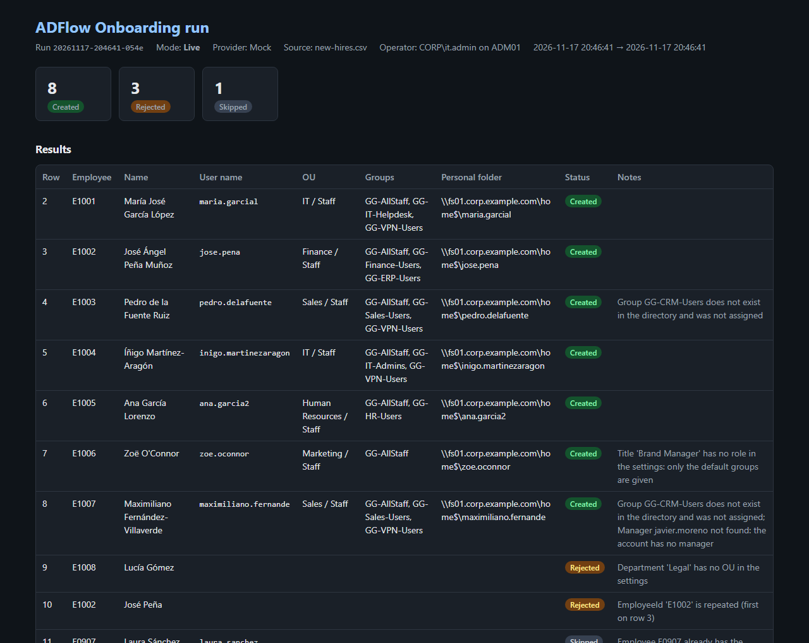
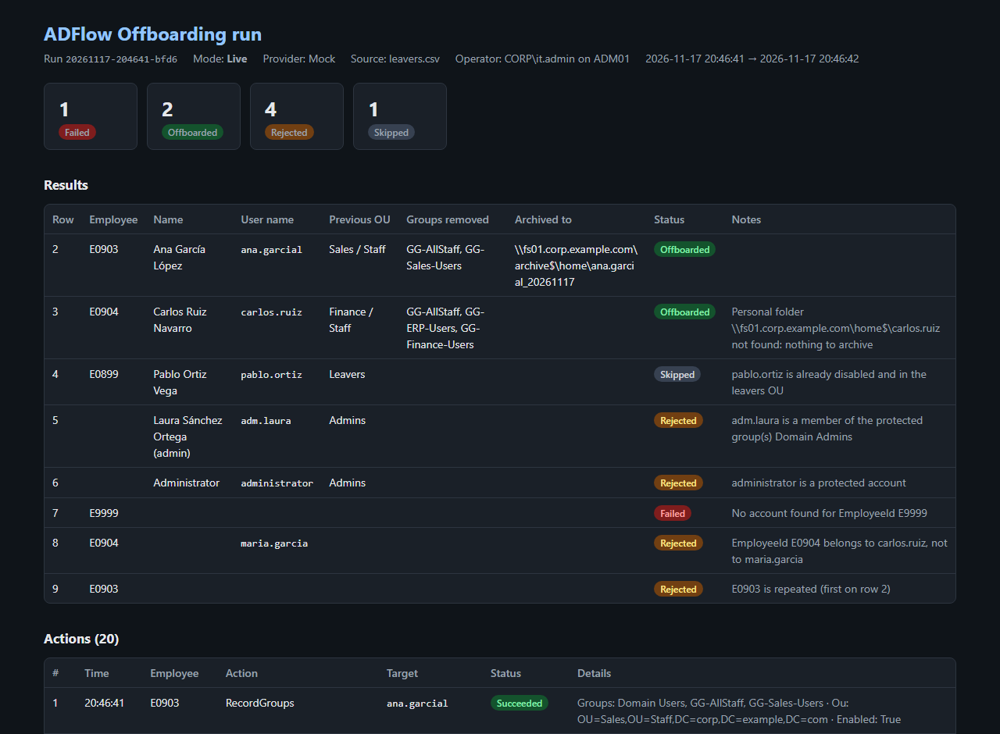
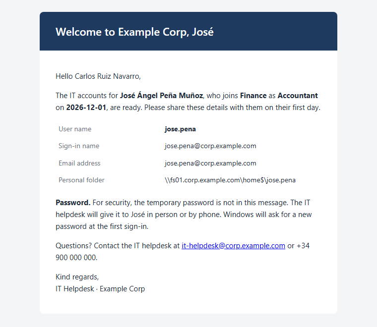

# ADFlow

[](https://github.com/DavidGoRi/ADFlow/actions/workflows/ci.yml)


*Read in [English](README.md).*

**Altas y bajas de usuarios automatizadas en Active Directory, escritas en PowerShell.**

RR. HH. envía un CSV con las personas que se incorporan el mes que viene. ADFlow
convierte cada fila en una cuenta lista para usar: un nombre de usuario único, la
OU de su departamento, los grupos de su puesto y una contraseña temporal que hay
que cambiar en el primer inicio de sesión. También crea su carpeta personal con
los permisos NTFS adecuados y prepara un correo de bienvenida para su
responsable. Cuando alguien se va, otro CSV cierra
su cuenta: deshabilitada, fuera de sus grupos, en la OU de bajas y con sus
archivos archivados. Cada acción queda registrada con lo necesario para
deshacerla, y una sola orden revierte una ejecución entera. Cada ejecución
termina con un informe HTML que se puede adjuntar al ticket.

> **Versión 1.0.0.** Descarga `ADFlow-1.0.0.zip` desde las
> [versiones publicadas](https://github.com/DavidGoRi/ADFlow/releases/latest) o
> clona el repositorio. La demo funciona en cualquier Windows 10/11, sin dominio;
> una [guía de laboratorio](docs/LAB.es.md) monta un dominio de pruebas gratuito
> en Hyper-V para probarlo contra un Active Directory real.



| Informe de bajas | Borrador del correo de bienvenida |
| --- | --- |
|  |  |

*Todas las personas, identificadores y dominios de las capturas y de los datos de
ejemplo son ficticios. El informe y los mensajes están en inglés, como el código.*
## Por qué está hecho así

La lógica nunca llama directamente al módulo ActiveDirectory. Habla con un
**proveedor de directorio**, un objeto pequeño con métodos como `FindUser`,
`NewUser`, `AddGroupMember`, `SetEnabled` y `MoveUser`. Hay dos implementaciones:

| Proveedor | Para qué | Estado |
| --- | --- | --- |
| `Mock` | tests, la demo y cualquier PC sin dominio | listo |
| `ActiveDirectory` | un dominio real, con RSAT (`New-ADUser`, `Add-ADGroupMember`…) | listo |

Así, todas las reglas (nombres, OU, grupos, validación, protecciones,
idempotencia, registro y reversión) se prueban con Pester en un Windows normal y
en GitHub Actions, sin controlador de dominio.

El proveedor de Active Directory también se prueba: los tests cargan un pequeño
módulo ActiveDirectory simulado ([`tests/FakeActiveDirectory.psm1`](tests/FakeActiveDirectory.psm1))
y pasan **los mismos tests de contrato** a los dos proveedores, incluido el ciclo
completo de altas, bajas y reversión. Además comprueban lo que solo importa en
AD: todos los valores de los filtros LDAP se escapan (un nombre como `*)(cn=*` es
texto normal), el servidor y la credencial llegan a todos los cmdlets, los
borrados nunca piden confirmación, los valores vacíos no se pasan a `New-ADUser`
y una segunda "Ana Soto" en la misma OU recibe un CN único. Lo que solo se ve en
un dominio real (permisos de la cuenta de servicio, replicación, directivas de
contraseñas) es para lo que sirve el [laboratorio](docs/LAB.es.md).

Las bajas y la reversión describen cada cambio como datos, por ejemplo
`@{ Action = 'MoveUser'; SamAccountName = 'ana.soto'; TargetOu = '…' }`. Ese mismo
objeto se escribe en la auditoría junto con su acción inversa, y los dos se
ejecutan con una sola función, `Invoke-ADFlowAction`. Por eso la reversión es
fiable: deshacer una ejecución es aplicar sus acciones inversas.

```
CSV de altas ─► Import-ADFlowHireFile ───► Invoke-ADFlowOnboarding ──┐
CSV de bajas ─► Import-ADFlowLeaverFile ─► Invoke-ADFlowOffboarding ─┼─► proveedor de directorio ── Mock (JSON)
configuración ► Get-ADFlowConfig                                     │   (Invoke-ADFlowAction)     └ ActiveDirectory (RSAT)
                                                                     │
                        auditoría (audit.jsonl + undo) ◄─────────────┘
                                   │
                                   └──► Undo-ADFlowRun: acciones inversas, de la última a la primera
```

## Funciones

### Altas

- **Nombres de usuario únicos.** `María José García López` → `maria.garcia`. Si
  está ocupado: `maria.garcial` (inicial del segundo apellido), después
  `maria.garcia2`, `maria.garcia3`… Quita tildes y letras especiales (`Íñigo` →
  `inigo`, `Groß` → `gross`), mantiene las partículas con su apellido (`de la
  Fuente` → `delafuente`), une guiones y apóstrofos (`O'Connor` → `oconnor`) y
  respeta el límite de 20 caracteres de `sAMAccountName` sin perder el número
  final. También evita los nombres asignados antes en la misma ejecución.
- **OU según el departamento y grupos según el puesto**, desde un JSON. La
  comparación no distingue mayúsculas, tildes ni espacios de más. Los
  departamentos desconocidos se rechazan; los puestos desconocidos reciben solo
  los grupos por defecto, con un aviso.
- **Contraseñas temporales seguras** de un generador criptográfico, con
  mayúsculas, minúsculas, números y símbolos, y sin caracteres que se confunden
  (`O/0`, `I/l/1`). Solo se devuelven como `SecureString` y nunca se escriben en
  disco. Las cuentas se crean con *cambiar la contraseña en el siguiente inicio
  de sesión*.
- **Validación del CSV**: separado por comas o por punto y coma (Excel en español
  usa `;`), UTF-8, columnas obligatorias, identificadores repetidos o mal
  formados y fechas no válidas. Una fila errónea no detiene las demás.
- **Idempotente**: si el `EmployeeId` ya está en el directorio, la persona se
  omite, así que el mismo archivo se puede ejecutar dos veces sin riesgo.
- **Carpeta personal con permisos NTFS**: `<raíz>\<usuario>` se crea con sus
  permisos en un solo paso (nunca queda abierta entre medias). Se corta la
  herencia del recurso compartido y solo quedan SYSTEM, Administradores y los
  grupos de administración con control total, y el usuario con *Modificar*
  (trabaja con sus archivos, pero no puede cambiar los permisos). La carpeta y la
  letra de unidad se guardan en la cuenta. Una carpeta que ya existe no se toca, y
  si el recurso compartido no responde solo se genera un aviso.
- **Borrador del correo de bienvenida** para cada alta, a partir de una plantilla
  HTML ([`config/welcome.html`](config/welcome.html)), guardado como `.eml` sin
  enviar: Outlook lo abre como borrador para que IT lo revise y lo envíe. Va al
  responsable, con copia al servicio de soporte, y **nunca incluye la contraseña**.

### Bajas

Para cada baja, en este orden:

1. busca la cuenta por `EmployeeId` o `SamAccountName` (y rechaza la fila si se
   dan los dos y apuntan a cuentas distintas);
2. rechaza las **cuentas protegidas** (`administrator`, `krbtgt`…) y los miembros
   de **grupos protegidos** (`Domain Admins`…);
3. **guarda en el registro sus grupos**, su OU, su estado y su descripción antes
   de tocar nada;
4. deshabilita la cuenta;
5. escribe la fecha y el motivo de la baja en la descripción;
6. la quita de todos sus grupos, salvo los que hay que conservar (`Domain Users`);
7. la mueve a la OU de bajas;
8. mueve su carpeta personal al archivo como `<usuario>_<aaaaMMdd>` (también entre
   unidades o recursos compartidos distintos).

Las cuentas que ya están deshabilitadas y en la OU de bajas se omiten. Si un paso
falla, no se intentan los siguientes de esa persona y el resultado indica cuántos
pasos anteriores se pueden deshacer.

### Reversión

`Undo-ADFlowRun` (o `ADFlow.ps1 -Action Undo -RunId …`) lee la auditoría de una
ejecución y aplica las acciones inversas de la última a la primera:

- tras unas **bajas**, la carpeta vuelve a su sitio y la cuenta vuelve a su OU y
  a sus grupos, recupera su descripción y se habilita;
- tras unas **altas**, las cuentas nuevas salen de sus grupos y se eliminan.

La reversión es una ejecución con su propia auditoría. La ejecución original
queda marcada con `rollback.json` y no se deshace dos veces salvo con `-Force`.
Las simulaciones, las ejecuciones con `-WhatIf` y las reversiones no se pueden
deshacer (no cambiaron nada que deshacer). Un fallo no detiene el resto: la
reversión deshace todo lo que puede e informa de lo que ha fallado.

### Comunes

- **Tres modos**: `-DryRun` (calcula todo el plan y lo registra como *Planned*),
  el `-WhatIf` estándar y el modo real.
- **Auditoría** de cada ejecución en `output\runs\<RunId>\`: `audit.jsonl` (se
  escribe sobre la marcha), `audit.csv` y `summary.json`.
- **Informe HTML** de cada ejecución (`report.html`): un único archivo con los
  totales, cada fila con su estado y cada acción con sus detalles y si se puede
  deshacer. Sigue el tema claro u oscuro, se imprime bien y escapa todo lo que ha
  escrito RR. HH. Cuando una ejecución se revierte, su informe lo indica.
  `-Action Report -RunId …` lo vuelve a generar.

## Inicio rápido

Requisitos: Windows PowerShell 5.1 (incluido en Windows 10/11). No hace falta nada
más para probarlo: la demo usa el directorio simulado.

```powershell
git clone https://github.com/DavidGoRi/ADFlow.git
cd ADFlow

# Altas: ver qué pasaría y hacerlas en el directorio simulado,
# con las carpetas personales en una carpeta local en vez del recurso de ejemplo
New-Item -ItemType Directory -Path .\output\home -Force
.\ADFlow.ps1 -Action Onboard -CsvPath .\demo\new-hires.csv -HomeRoot .\output\home -DryRun
.\ADFlow.ps1 -Action Onboard -CsvPath .\demo\new-hires.csv -HomeRoot .\output\home -ResetMockDirectory

# Cada ejecución indica dónde están su report.html y los borradores de bienvenida

# Bajas, con una carpeta personal ficticia para archivar
New-Item -ItemType Directory -Path .\output\home\ana.garcial -Force
.\ADFlow.ps1 -Action Offboard -CsvPath .\demo\leavers.csv -HomeRoot .\output\home -ArchiveRoot .\output\archive

# Deshacerlas (el identificador sale al final de la orden anterior)
.\ADFlow.ps1 -Action Undo -RunId 20261117-175912-1a43 -HomeRoot .\output\home -ArchiveRoot .\output\archive
```

Simulación de las altas de la demo (todos los nombres y datos son ficticios):

```
Planned    E1001   maria.garcial         María José García López
Planned    E1002   jose.pena             José Ángel Peña Muñoz
Planned    E1003   pedro.delafuente      Pedro de la Fuente Ruiz
           Group GG-CRM-Users does not exist in the directory and was not assigned
Planned    E1004   inigo.martinezaragon  Íñigo Martínez-Aragón
Planned    E1005   ana.garcia2           Ana García Lorenzo
Planned    E1006   zoe.oconnor           Zoë O'Connor
           Title 'Brand Manager' has no role in the settings: only the default groups are given
Planned    E1007   maximiliano.fernande  Maximiliano Fernández-Villaverde
           Group GG-CRM-Users does not exist in the directory and was not assigned; Manager javier.moreno not found: the account has no manager
Rejected   E1008   -                     Lucía Gómez
           Department 'Legal' has no OU in the settings
Rejected   E1002   -                     José Peña
           EmployeeId 'E1002' is repeated (first on row 3)
Skipped    E0907   laura.sanchez         Laura Sánchez Ortega
           Employee E0907 already has the account laura.sanchez
Rejected   E1009   -                     Sofía
           LastName is empty; StartDate '2026-13-01' is not a yyyy-MM-dd date
Planned    E1010   jose.penam            José Ángel Peña Moreno

Run 20261117-174252-2246: 8 Planned, 3 Rejected, 1 Skipped
```

Las bajas de la demo:

```
Offboarded E0903   ana.garcial           Ana García López
Offboarded E0904   carlos.ruiz           Carlos Ruiz Navarro
           Personal folder C:\…\ADFlow\output\home\carlos.ruiz not found: nothing to archive
Skipped    E0899   pablo.ortiz           Pablo Ortiz Vega
           pablo.ortiz is already disabled and in the leavers OU
Rejected           adm.laura             Laura Sánchez Ortega (admin)
           adm.laura is a member of the protected group(s) Domain Admins
Rejected           administrator         Administrator
           administrator is a protected account
Failed     E9999   -
           No account found for EmployeeId E9999
Rejected   E0904   maria.garcia
           EmployeeId E0904 belongs to carlos.ruiz, not to maria.garcia
Rejected   E0903   -
           E0903 is repeated (first on row 2)

Run 20261117-175912-1a43: 2 Offboarded, 1 Skipped, 4 Rejected, 1 Failed
```

Y su reversión:

```
Reverted  #14   MoveUser           carlos.ruiz           Move to OU=Finance,OU=Staff,DC=corp,DC=example,DC=com
Reverted  #13   AddGroupMember     carlos.ruiz           Add to group GG-Finance-Users
Reverted  #12   AddGroupMember     carlos.ruiz           Add to group GG-ERP-Users
Reverted  #11   AddGroupMember     carlos.ruiz           Add to group GG-AllStaff
Reverted  #10   SetDescription     carlos.ruiz           Set description ''
Reverted  #9    SetEnabled         carlos.ruiz           Enable account
Reverted  #7    MoveFolder         …\archive\ana.garcial_20261117 Move folder to …\home\ana.garcial
Reverted  #6    MoveUser           ana.garcial           Move to OU=Sales,OU=Staff,DC=corp,DC=example,DC=com
Reverted  #5    AddGroupMember     ana.garcial           Add to group GG-Sales-Users
Reverted  #4    AddGroupMember     ana.garcial           Add to group GG-AllStaff
Reverted  #3    SetDescription     ana.garcial           Set description ''
Reverted  #2    SetEnabled         ana.garcial           Enable account

Run 20261117-175912-c371: 12 Reverted
```

Los mensajes del programa están en inglés, como el código.

### Contra Active Directory

Requisitos: el módulo ActiveDirectory (RSAT, o ejecutarlo en un controlador de
dominio) y una cuenta que pueda crear, cambiar, mover y borrar usuarios en las
OU de la configuración y gestionar sus grupos. Adapta
[`config/adflow.json`](config/adflow.json) a tu dominio y empieza con una
simulación:

```powershell
.\ADFlow.ps1 -Action Onboard -CsvPath .\altas.csv -Provider ActiveDirectory -HomeRoot \\fs01\home$ -DryRun
.\ADFlow.ps1 -Action Onboard -CsvPath .\altas.csv -Provider ActiveDirectory -HomeRoot \\fs01\home$ `
    -Server dc01.corp.example.com -Credential (Get-Credential)
```

Para probarlo antes sin riesgo, sigue la [guía del laboratorio](docs/LAB.es.md):
un dominio de pruebas gratuito en Hyper-V, cargado con los datos de ejemplo por
`tools/New-ADFlowLab.ps1`.

### Parámetros de `ADFlow.ps1`

| Parámetro | Por defecto | Descripción |
| --- | --- | --- |
| `-Action` | | `Onboard` (altas), `Offboard` (bajas), `Undo` (revertir) o `Report` (informe) |
| `-CsvPath` | | CSV de RR. HH., para `Onboard` y `Offboard` |
| `-RunId` | | Ejecución que se revierte (`Undo`) o cuyo informe se regenera (`Report`) |
| `-ConfigPath` | `config\adflow.json` | Dominio, OU, puestos, grupos y reglas de bajas |
| `-Provider` | `Mock` | `Mock` (simulado) o `ActiveDirectory` |
| `-Server`, `-Credential` | los actuales | Controlador de dominio y cuenta, para `ActiveDirectory` |
| `-MockSeedPath` | `demo\directory.json` | Estado inicial del directorio simulado |
| `-MockStatePath` | `output\mock-directory.json` | Dónde guarda sus cambios el directorio simulado |
| `-LogPath` | `output\runs` | Carpeta de la auditoría |
| `-HomeRoot`, `-ArchiveRoot` | de la configuración | Cambian dónde están y dónde se archivan las carpetas personales |
| `-DryRun` | | Solo el plan, sin cambios |
| `-WhatIf` | | Vista previa estándar de PowerShell |
| `-Force` | | Revierte una ejecución que ya se había revertido |
| `-ResetMockDirectory` | | Vuelve a empezar el directorio simulado desde el estado inicial |
| `-PassThru` | | Devuelve los resultados (contraseñas como `SecureString`) |

## CSV de RR. HH.

CSV en UTF-8 con cabecera, separado por `,` o `;`.

**Altas** ([`demo/new-hires.csv`](demo/new-hires.csv)):

```
EmployeeId;FirstName;LastName;Department;Title;Manager;StartDate
E1001;María José;García López;IT;Helpdesk Technician;laura.sanchez;2026-12-01
```

| Columna | Obligatoria | Notas |
| --- | --- | --- |
| `EmployeeId` | sí | De 1 a 16 letras, números o guiones; único en el archivo |
| `FirstName`, `LastName` | sí | Nombre y apellidos completos, con tildes; dos apellidos sin problema |
| `Department` | sí | Debe existir en la configuración |
| `Title` | sí | Puesto; los desconocidos reciben solo los grupos por defecto |
| `Manager` | no | `sAMAccountName` del responsable |
| `StartDate` | no | `yyyy-MM-dd` |

**Bajas** ([`demo/leavers.csv`](demo/leavers.csv)):

```
EmployeeId;SamAccountName;LeaveDate;Reason
E0903;;2026-11-30;Resignation
;carlos.ruiz;2026-11-30;End of contract
```

| Columna | Obligatoria | Notas |
| --- | --- | --- |
| `EmployeeId`, `SamAccountName` | una de las dos | Si se dan las dos, deben ser la misma cuenta |
| `LeaveDate` | no | `yyyy-MM-dd`; hoy si está vacía. Va a la descripción |
| `Reason` | no | Va a la descripción |

## Configuración

[`config/adflow.json`](config/adflow.json):

```json
{
  "domain": { "upnSuffix": "corp.example.com", "mailDomain": "corp.example.com" },
  "naming": { "maxLength": 20 },
  "password": { "length": 16 },
  "defaultGroups": [ "GG-AllStaff" ],
  "departments": {
    "IT": { "ou": "OU=IT,OU=Staff,DC=corp,DC=example,DC=com" }
  },
  "roles": {
    "Helpdesk Technician": [ "GG-IT-Helpdesk", "GG-VPN-Users" ]
  },
  "homeFolders": {
    "root": "\\\\fs01.corp.example.com\\home$",
    "drive": "H:",
    "adminGroups": [ "GG-IT-Admins" ]
  },
  "welcome": {
    "template": "welcome.html",
    "subject": "Welcome to {{CompanyName}}, {{GivenName}}",
    "from": "it-helpdesk@corp.example.com",
    "companyName": "Example Corp",
    "helpdeskEmail": "it-helpdesk@corp.example.com",
    "helpdeskPhone": "+34 900 000 000"
  },
  "offboarding": {
    "ou": "OU=Leavers,DC=corp,DC=example,DC=com",
    "archiveRoot": "\\\\fs01.corp.example.com\\archive$\\home",
    "keepGroups": [ "Domain Users" ],
    "protectedAccounts": [ "administrator", "krbtgt" ],
    "protectedGroups": [ "Domain Admins", "Enterprise Admins", "Schema Admins" ]
  }
}
```

El archivo se valida al cargarlo y se informa de todos los problemas a la vez.
Las rutas relativas (la plantilla de bienvenida) son relativas al archivo de
configuración. La plantilla puede usar `{{GivenName}}`, `{{DisplayName}}`,
`{{SamAccountName}}`, `{{UserPrincipalName}}`, `{{Mail}}`, `{{Department}}`,
`{{Title}}`, `{{StartDate}}`, `{{ManagerName}}`, `{{HomeFolder}}`,
`{{CompanyName}}`, `{{HelpdeskEmail}}` y `{{HelpdeskPhone}}`; un marcador
desconocido es un error, para que una errata nunca llegue a una persona nueva.

## Auditoría

Cada ejecución escribe una carpeta `output\runs\<aaaaMMdd-HHmmss-xxxx>\`. Cada
línea de `audit.jsonl` es una acción; los cambios llevan su acción inversa:

```json
{"timestamp":"2026-11-17T17:59:12.4011501+01:00","runId":"20261117-175912-1a43","sequence":6,
 "action":"MoveUser","target":"ana.garcial","employeeId":"E0903","status":"Succeeded","message":"",
 "details":{"SamAccountName":"ana.garcial","TargetOu":"OU=Leavers,DC=corp,DC=example,DC=com"},
 "undo":{"Action":"MoveUser","SamAccountName":"ana.garcial","TargetOu":"OU=Sales,OU=Staff,DC=corp,DC=example,DC=com"}}
```

Estados: `Succeeded`, `Failed`, `Planned` (simulación), `WhatIf`, `Skipped` y
`Rejected`. El registro rechaza cualquier dato llamado `Password` o que sea un
`SecureString`. `output\` está en `.gitignore`: en un uso real contiene datos
personales.

## Tests

311 tests de Pester cubren la generación de nombres, las contraseñas, la
configuración, los dos CSV, el directorio simulado, el catálogo de acciones, el
archivado de carpetas, la auditoría, las altas, las bajas (protecciones, fallos a
medias e idempotencia), la reversión (restauración exacta, orden, protección
contra deshacer dos veces y fallos), las carpetas personales (los permisos NTFS
se aplican de verdad y se vuelven a leer), los borradores de bienvenida
(cabeceras, tildes y ausencia de contraseña), los informes HTML (escapado y
avisos), el proveedor de Active Directory (tests de contrato compartidos con el
directorio simulado), el script del laboratorio, el script de entrada y el zip de la versión (se
genera, se descomprime y se ejecuta). El
directorio simulado da a cada cuenta y grupo
un SID ficticio, así que los permisos de las carpetas son entradas NTFS reales
aunque no haya dominio. También comprueban
que todos los scripts están en UTF-8 con BOM (Windows PowerShell 5.1 lo necesita
para leer bien las tildes) y que los datos de ejemplo solo usan el dominio
reservado `example.com`.

```powershell
Install-Module Pester -MinimumVersion 5.5 -Scope CurrentUser -SkipPublisherCheck
Install-Module PSScriptAnalyzer -Scope CurrentUser

Invoke-Pester -Path .\tests
Invoke-ScriptAnalyzer -Path . -Recurse -Settings .\PSScriptAnalyzerSettings.psd1
```

GitHub Actions ejecuta ambos en Windows PowerShell 5.1 con cada *push*.

## Hoja de ruta

1. **Núcleo y altas** ✅: capa de proveedor y directorio simulado, nombres
   únicos, OU y grupos, contraseñas, validación del CSV, `-DryRun`/`-WhatIf`,
   auditoría, tests y CI.
2. **Bajas y reversión** ✅: deshabilitar, guardar y quitar los grupos, OU de
   bajas, archivado de la carpeta, cuentas protegidas; `Undo-ADFlowRun`.
3. **Carpetas personales, correo de bienvenida e informe** ✅: carpeta personal
   con permisos NTFS al dar de alta, borrador del correo de bienvenida desde una
   plantilla e informe HTML de cada ejecución.
4. **Proveedor de Active Directory y laboratorio** ✅: los mismos métodos sobre
   RSAT, tests de contrato para los dos proveedores, `tools/New-ADFlowLab.ps1` y
   una [guía](docs/LAB.es.md) para montar un dominio de pruebas con Windows
   Server Evaluation en Hyper-V.
5. **Versión 1.0.0** ✅: capturas, registro de cambios y un zip de la versión con
   su suma SHA-256, generado y publicado por GitHub Actions a partir de la
   etiqueta de versión.

## Estructura

```
ADFlow.ps1                 punto de entrada
config/adflow.json         configuración de ejemplo (dominio ficticio)
config/welcome.html        plantilla del correo de bienvenida
demo/new-hires.csv         CSV de altas de ejemplo
demo/leavers.csv           CSV de bajas de ejemplo
demo/directory.json        estado inicial del directorio simulado
src/Naming.ps1             tildes y nombres de usuario únicos
src/Password.ps1           contraseñas temporales
src/Config.ps1             configuración, departamentos y puestos
src/HRFile.ps1             lectura y validación de los CSV de RR. HH.
src/MockDirectory.ps1      proveedor de directorio simulado
src/ADDirectory.ps1        proveedor de Active Directory (RSAT)
src/Actions.ps1            cambios descritos como datos y cómo aplicarlos
src/HomeFolder.ps1         carpetas personales: permisos, creación y archivado
src/Welcome.ps1            borradores del correo de bienvenida
src/Report.ps1             informe HTML (src/report-template.html)
src/Audit.ps1              auditoría
src/Onboarding.ps1         altas
src/Offboarding.ps1        bajas
src/Rollback.ps1           reversión
tools/New-ADFlowLab.ps1    carga los datos de ejemplo en un dominio de laboratorio
tools/Build-Release.ps1    genera ADFlow-<versión>.zip y su suma de comprobación
docs/LAB.es.md             guía del laboratorio (Hyper-V + Windows Server Evaluation)
tests/                     tests de Pester y el módulo ActiveDirectory simulado
```

## Licencia

[MIT](LICENSE). Todas las personas, identificadores y dominios de este repositorio
son ficticios.
