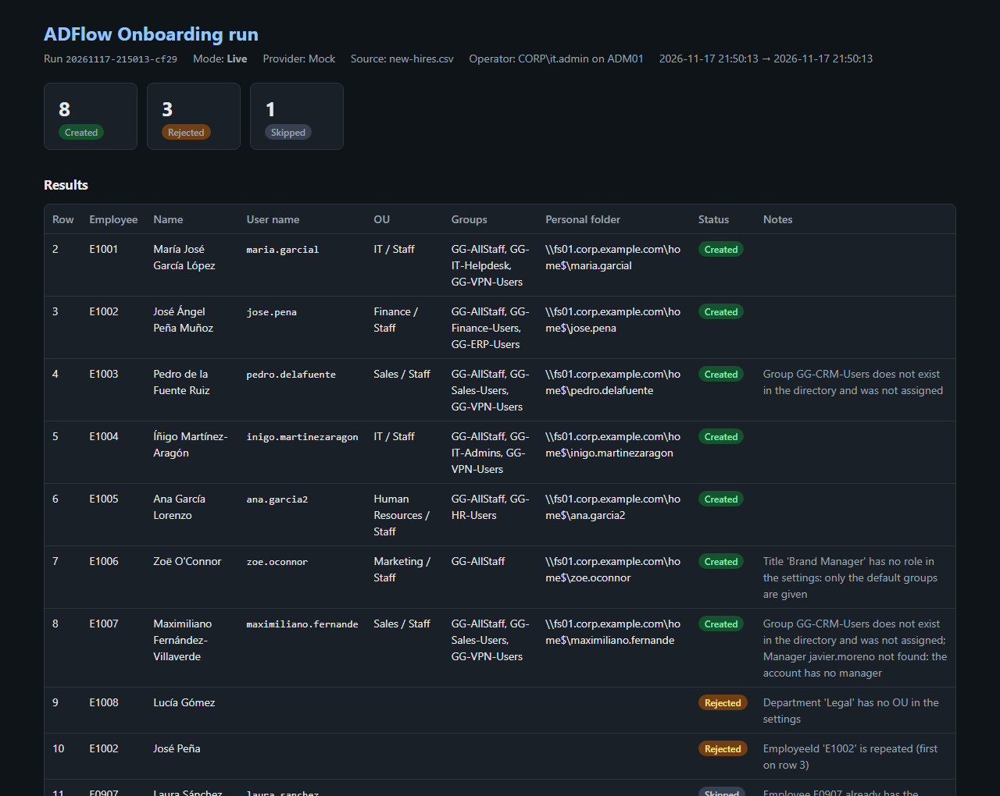
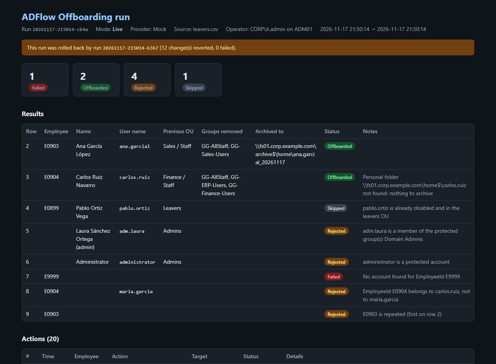
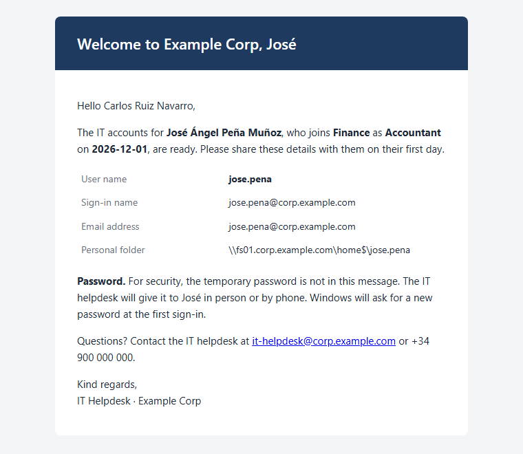

# ADFlow

[](https://github.com/DavidGoRi/ADFlow/actions/workflows/ci.yml)


[](https://davidgori.github.io/ADFlow/)

*Leer en [español](README.es.md).*

**Automated joiner and leaver processing for Active Directory, written in PowerShell.**

HR sends a CSV with the people who start next month. ADFlow turns each row into
a ready-to-use account: a unique user name, the right OU for the department, the
right groups for the job title and a temporary password that must be changed at
the first logon. It also creates their personal folder with the right NTFS
permissions and drafts a welcome email for their manager. When people leave, another CSV closes their accounts: disabled,
out of their groups, moved to the leavers OU and with their files archived.
Every action is logged with the information needed to undo it, and a single
command reverts a whole run. Each run ends with an HTML report that can be
attached to the ticket.

### ▶ [Open the live demo](https://davidgori.github.io/ADFlow/)

A real ADFlow cycle on fictitious data, step by step: the HR files, the console
output, the HTML reports of the onboarding, the offboarding and the rollback, and
a welcome email. GitHub Actions rebuilds it every week. Nothing to install.


> **Version 1.0.0.** Download `ADFlow-1.0.0.zip` from the
> [releases](https://github.com/DavidGoRi/ADFlow/releases/latest), or clone the
> repository. The demo runs on any Windows 10/11 computer, without a domain; a
> [lab guide](docs/LAB.md) builds a free test domain in Hyper-V to try it against
> real Active Directory.



| Offboarding report | Welcome email draft |
| --- | --- |
|  |  |

*All people, ids and domains in the screenshots and the sample data are fictitious.*
## Why it is built this way

The logic never calls the ActiveDirectory module directly. It talks to a
**directory provider**, a small object with methods such as `FindUser`,
`NewUser`, `AddGroupMember`, `SetEnabled` and `MoveUser`. Two providers
implement it:

| Provider | Used for | Status |
| --- | --- | --- |
| `Mock` | tests, the demo, any PC without a domain | ready |
| `ActiveDirectory` | a real domain, through RSAT (`New-ADUser`, `Add-ADGroupMember`…) | ready |

Because of that, every rule (names, OUs, groups, validation, protections,
idempotency, logging, rollback) is tested with Pester on a normal Windows
computer and in GitHub Actions, without a domain controller.

The Active Directory provider is tested too: the tests load a small simulated
ActiveDirectory module ([`tests/FakeActiveDirectory.psm1`](tests/FakeActiveDirectory.psm1))
and run the **same contract tests** against both providers, including the whole
onboarding → offboarding → rollback cycle. They also check what only matters in
AD: every LDAP filter value is escaped (a name like `*)(cn=*` is plain text), the
server and credential reach every cmdlet, deletions never ask for confirmation,
empty values are left out of `New-ADUser`, and a second "Ana Soto" in the same OU
gets a unique CN. Behaviour that only a real domain shows (rights of the
service account, replication, password policies) is what the
[lab](docs/LAB.md) is for.

Offboarding and rollback describe every change as data, for example
`@{ Action = 'MoveUser'; SamAccountName = 'ana.soto'; TargetOu = '…' }`. The
same object is written to the audit trail together with its reverse action, and
both are run by one function, `Invoke-ADFlowAction`. That is what makes the
rollback reliable: undoing a run is replaying its reverse actions.

```
HR CSV ──► Import-ADFlowHireFile ───► Invoke-ADFlowOnboarding ──┐
leavers ─► Import-ADFlowLeaverFile ─► Invoke-ADFlowOffboarding ─┼─► directory provider ── Mock (JSON)
settings ► Get-ADFlowConfig                                     │   (Invoke-ADFlowAction) └ ActiveDirectory (RSAT)
                                                                │
                      audit trail (audit.jsonl + undo) ◄────────┘
                                 │
                                 └──► Undo-ADFlowRun: reverse actions, last to first
```

## Features

### Onboarding

- **Unique user names.** `María José García López` → `maria.garcia`. If it is
  taken: `maria.garcial` (initial of the second surname), then `maria.garcia2`,
  `maria.garcia3`… Accents and special letters are folded (`Íñigo` → `inigo`,
  `Groß` → `gross`), particles stay with their surname (`de la Fuente` →
  `delafuente`), hyphens and apostrophes are joined (`O'Connor` → `oconnor`) and
  the 20-character limit of `sAMAccountName` is respected without losing the
  numeric suffix. Names handed out earlier in the same run are also avoided.
- **OU by department and groups by job title**, from a JSON file. Matching
  ignores case, accents and extra spaces. Unknown departments are rejected;
  unknown titles only get the default groups, with a warning.
- **Secure temporary passwords** from a cryptographic generator, with upper and
  lower case letters, digits and symbols, without look-alike characters
  (`O/0`, `I/l/1`). They are returned only as `SecureString` and are never written
  to disk. Accounts are created with *change password at next logon*.
- **HR file validation**: comma or semicolon separated (Excel in Spanish uses
  `;`), UTF-8, required columns, repeated or malformed employee ids, invalid
  dates. One bad row does not stop the others.
- **Idempotent**: a person whose `EmployeeId` is already in the directory is
  skipped, so the same file can be run twice safely.
- **Personal folder with NTFS permissions**: `<root>\<user>` is created with
  its permissions in one step (never open in between). Inheritance from the
  share is cut and only these entries remain: SYSTEM, Administrators and the
  admin groups with full control, and the user with *Modify* (they can work with
  their files but not change the permissions). The folder and drive letter are
  stored in the account. An existing folder is never touched, and an unreachable
  share only produces a warning.
- **Welcome email draft** for each new hire, built from an HTML template
  ([`config/welcome.html`](config/welcome.html)) and saved as an unsent `.eml`:
  Outlook opens it as a draft that IT can check and send. It goes to the
  manager, with a copy to the helpdesk, and **never contains the password**.

### Offboarding

For each leaver, in this order:

1. find the account by `EmployeeId` or `SamAccountName` (and reject the row when
   both are given and point to different accounts);
2. refuse **protected accounts** (`administrator`, `krbtgt`…) and members of
   **protected groups** (`Domain Admins`…);
3. **record the group membership**, OU, state and description before touching
   anything;
4. disable the account;
5. write the leave date and reason in its description;
6. remove it from every group except the ones to keep (`Domain Users`);
7. move it to the leavers OU;
8. move its personal folder to the archive as `<user>_<yyyyMMdd>` (also across
   drives or shares).

An account already disabled and in the leavers OU is skipped. If a step fails,
the remaining steps of that person are not attempted and the result says how
many earlier steps can be undone.

### Rollback

`Undo-ADFlowRun` (or `ADFlow.ps1 -Action Undo -RunId …`) reads the audit trail
of a run and replays the reverse actions from the last to the first:

- after an **offboarding**, the folder returns, the account goes back to its OU
  and groups, gets its old description and is enabled again;
- after an **onboarding**, the new accounts are removed from their groups and
  deleted.

The rollback is a run of its own with its own audit trail. The original run is
marked with `rollback.json` and is not undone twice unless `-Force` is used.
Dry runs, `-WhatIf` runs and rollbacks cannot be undone (there is nothing to
undo). One failure does not stop the rest: the rollback reverts as much as it can
and reports what failed.

### Common to all actions

- **Three modes**: `-DryRun` (works out the whole plan and logs it as *Planned*),
  standard `-WhatIf`, and live.
- **Audit trail** per run in `output\runs\<RunId>\`: `audit.jsonl` (written as
  it happens), `audit.csv` and `summary.json`.
- **HTML report** per run (`report.html`): one self-contained file with the
  totals, every row with its status and every action with its details and
  whether it can be undone. It follows the light or dark theme, prints well and
  escapes everything HR typed. When a run is rolled back, its report says so.
  `-Action Report -RunId …` writes it again.

## Quick start

Requirements: Windows PowerShell 5.1 (included in Windows 10/11). Nothing else
is needed to try it: the demo uses the simulated directory.

```powershell
git clone https://github.com/DavidGoRi/ADFlow.git
cd ADFlow

# Onboarding: see what would happen, then do it in the simulated directory,
# with the personal folders in a local folder instead of the sample share
New-Item -ItemType Directory -Path .\output\home -Force
.\ADFlow.ps1 -Action Onboard -CsvPath .\demo\new-hires.csv -HomeRoot .\output\home -DryRun
.\ADFlow.ps1 -Action Onboard -CsvPath .\demo\new-hires.csv -HomeRoot .\output\home -ResetMockDirectory

# Each run prints where its report.html and welcome drafts are

# Offboarding, with a fictitious personal folder to archive
New-Item -ItemType Directory -Path .\output\home\ana.garcial -Force
.\ADFlow.ps1 -Action Offboard -CsvPath .\demo\leavers.csv -HomeRoot .\output\home -ArchiveRoot .\output\archive

# Undo it (the run id is printed at the end of the previous command)
.\ADFlow.ps1 -Action Undo -RunId 20261117-175912-1a43 -HomeRoot .\output\home -ArchiveRoot .\output\archive
```

Dry run of the demo onboarding file (all names and data are fictitious):

```
Planned    E1001   maria.garcial         María José García López
Planned    E1002   jose.pena             José Ángel Peña Muñoz
Planned    E1003   pedro.delafuente      Pedro de la Fuente Ruiz
           Group GG-CRM-Users does not exist in the directory and was not assigned
Planned    E1004   inigo.martinezaragon  Íñigo Martínez-Aragón
Planned    E1005   ana.garcia2           Ana García Lorenzo
Planned    E1006   zoe.oconnor           Zoë O'Connor
           Title 'Brand Manager' has no role in the settings: only the default groups are given
Planned    E1007   maximiliano.fernande  Maximiliano Fernández-Villaverde
           Group GG-CRM-Users does not exist in the directory and was not assigned; Manager javier.moreno not found: the account has no manager
Rejected   E1008   -                     Lucía Gómez
           Department 'Legal' has no OU in the settings
Rejected   E1002   -                     José Peña
           EmployeeId 'E1002' is repeated (first on row 3)
Skipped    E0907   laura.sanchez         Laura Sánchez Ortega
           Employee E0907 already has the account laura.sanchez
Rejected   E1009   -                     Sofía
           LastName is empty; StartDate '2026-13-01' is not a yyyy-MM-dd date
Planned    E1010   jose.penam            José Ángel Peña Moreno

Run 20261117-174252-2246: 8 Planned, 3 Rejected, 1 Skipped
```

The demo offboarding file:

```
Offboarded E0903   ana.garcial           Ana García López
Offboarded E0904   carlos.ruiz           Carlos Ruiz Navarro
           Personal folder C:\…\ADFlow\output\home\carlos.ruiz not found: nothing to archive
Skipped    E0899   pablo.ortiz           Pablo Ortiz Vega
           pablo.ortiz is already disabled and in the leavers OU
Rejected           adm.laura             Laura Sánchez Ortega (admin)
           adm.laura is a member of the protected group(s) Domain Admins
Rejected           administrator         Administrator
           administrator is a protected account
Failed     E9999   -
           No account found for EmployeeId E9999
Rejected   E0904   maria.garcia
           EmployeeId E0904 belongs to carlos.ruiz, not to maria.garcia
Rejected   E0903   -
           E0903 is repeated (first on row 2)

Run 20261117-175912-1a43: 2 Offboarded, 1 Skipped, 4 Rejected, 1 Failed
```

And its rollback:

```
Reverted  #14   MoveUser           carlos.ruiz           Move to OU=Finance,OU=Staff,DC=corp,DC=example,DC=com
Reverted  #13   AddGroupMember     carlos.ruiz           Add to group GG-Finance-Users
Reverted  #12   AddGroupMember     carlos.ruiz           Add to group GG-ERP-Users
Reverted  #11   AddGroupMember     carlos.ruiz           Add to group GG-AllStaff
Reverted  #10   SetDescription     carlos.ruiz           Set description ''
Reverted  #9    SetEnabled         carlos.ruiz           Enable account
Reverted  #7    MoveFolder         …\archive\ana.garcial_20261117 Move folder to …\home\ana.garcial
Reverted  #6    MoveUser           ana.garcial           Move to OU=Sales,OU=Staff,DC=corp,DC=example,DC=com
Reverted  #5    AddGroupMember     ana.garcial           Add to group GG-Sales-Users
Reverted  #4    AddGroupMember     ana.garcial           Add to group GG-AllStaff
Reverted  #3    SetDescription     ana.garcial           Set description ''
Reverted  #2    SetEnabled         ana.garcial           Enable account

Run 20261117-175912-c371: 12 Reverted
```

### Against Active Directory

Requirements: the ActiveDirectory module (RSAT, or run it on a domain
controller) and an account that can create, change, move and delete users in the
OUs of the settings and manage their groups. Adapt
[`config/adflow.json`](config/adflow.json) to your domain, and start with a dry
run:

```powershell
.\ADFlow.ps1 -Action Onboard -CsvPath .\hires.csv -Provider ActiveDirectory -HomeRoot \\fs01\home$ -DryRun
.\ADFlow.ps1 -Action Onboard -CsvPath .\hires.csv -Provider ActiveDirectory -HomeRoot \\fs01\home$ `
    -Server dc01.corp.example.com -Credential (Get-Credential)
```

To try it safely first, follow the [lab guide](docs/LAB.md): a free test domain
in Hyper-V, filled with the sample data by `tools/New-ADFlowLab.ps1`.

### Parameters of `ADFlow.ps1`

| Parameter | Default | Description |
| --- | --- | --- |
| `-Action` | | `Onboard`, `Offboard`, `Undo` or `Report` |
| `-CsvPath` | | HR file, for `Onboard` and `Offboard` |
| `-RunId` | | Run to revert (`Undo`) or to report on again (`Report`) |
| `-ConfigPath` | `config\adflow.json` | Domain, OUs, roles, groups and offboarding rules |
| `-Provider` | `Mock` | `Mock` (simulated) or `ActiveDirectory` |
| `-Server`, `-Credential` | current ones | Domain controller and account, for `ActiveDirectory` |
| `-MockSeedPath` | `demo\directory.json` | Starting state of the simulated directory |
| `-MockStatePath` | `output\mock-directory.json` | Where the simulated directory keeps its changes |
| `-LogPath` | `output\runs` | Audit trail folder |
| `-HomeRoot`, `-ArchiveRoot` | from the settings | Override where personal folders live and are archived |
| `-DryRun` | | Plan only, no changes |
| `-WhatIf` | | Standard PowerShell preview |
| `-Force` | | Undo a run that was already rolled back |
| `-ResetMockDirectory` | | Start the simulated directory again from the seed |
| `-PassThru` | | Return the result objects (passwords as `SecureString`) |

## HR files

UTF-8 CSV with a header, separated by `,` or `;`.

**New hires** ([`demo/new-hires.csv`](demo/new-hires.csv)):

```
EmployeeId;FirstName;LastName;Department;Title;Manager;StartDate
E1001;María José;García López;IT;Helpdesk Technician;laura.sanchez;2026-12-01
```

| Column | Required | Notes |
| --- | --- | --- |
| `EmployeeId` | yes | 1-16 letters, digits or hyphens; unique in the file |
| `FirstName`, `LastName` | yes | Full names, with accents; two surnames are fine |
| `Department` | yes | Must exist in the settings |
| `Title` | yes | Job title; unknown titles get only the default groups |
| `Manager` | no | `sAMAccountName` of the manager |
| `StartDate` | no | `yyyy-MM-dd` |

**Leavers** ([`demo/leavers.csv`](demo/leavers.csv)):

```
EmployeeId;SamAccountName;LeaveDate;Reason
E0903;;2026-11-30;Resignation
;carlos.ruiz;2026-11-30;End of contract
```

| Column | Required | Notes |
| --- | --- | --- |
| `EmployeeId`, `SamAccountName` | one of them | When both are given they must be the same account |
| `LeaveDate` | no | `yyyy-MM-dd`; today when empty. Goes to the description |
| `Reason` | no | Goes to the description |

## Settings

[`config/adflow.json`](config/adflow.json):

```json
{
  "domain": { "upnSuffix": "corp.example.com", "mailDomain": "corp.example.com" },
  "naming": { "maxLength": 20 },
  "password": { "length": 16 },
  "defaultGroups": [ "GG-AllStaff" ],
  "departments": {
    "IT": { "ou": "OU=IT,OU=Staff,DC=corp,DC=example,DC=com" }
  },
  "roles": {
    "Helpdesk Technician": [ "GG-IT-Helpdesk", "GG-VPN-Users" ]
  },
  "homeFolders": {
    "root": "\\\\fs01.corp.example.com\\home$",
    "drive": "H:",
    "adminGroups": [ "GG-IT-Admins" ]
  },
  "welcome": {
    "template": "welcome.html",
    "subject": "Welcome to {{CompanyName}}, {{GivenName}}",
    "from": "it-helpdesk@corp.example.com",
    "companyName": "Example Corp",
    "helpdeskEmail": "it-helpdesk@corp.example.com",
    "helpdeskPhone": "+34 900 000 000"
  },
  "offboarding": {
    "ou": "OU=Leavers,DC=corp,DC=example,DC=com",
    "archiveRoot": "\\\\fs01.corp.example.com\\archive$\\home",
    "keepGroups": [ "Domain Users" ],
    "protectedAccounts": [ "administrator", "krbtgt" ],
    "protectedGroups": [ "Domain Admins", "Enterprise Admins", "Schema Admins" ]
  }
}
```

The file is validated on load and every problem is reported at once. Relative
paths (the welcome template) are relative to the settings file. The template can
use `{{GivenName}}`, `{{DisplayName}}`, `{{SamAccountName}}`,
`{{UserPrincipalName}}`, `{{Mail}}`, `{{Department}}`, `{{Title}}`,
`{{StartDate}}`, `{{ManagerName}}`, `{{HomeFolder}}`, `{{CompanyName}}`,
`{{HelpdeskEmail}}` and `{{HelpdeskPhone}}`; an unknown placeholder is an error,
so a typo never reaches a new hire.

## Audit trail

Each run writes a folder `output\runs\<yyyyMMdd-HHmmss-xxxx>\`. Every line of
`audit.jsonl` is one action; changes carry their reverse action:

```json
{"timestamp":"2026-11-17T17:59:12.4011501+01:00","runId":"20261117-175912-1a43","sequence":6,
 "action":"MoveUser","target":"ana.garcial","employeeId":"E0903","status":"Succeeded","message":"",
 "details":{"SamAccountName":"ana.garcial","TargetOu":"OU=Leavers,DC=corp,DC=example,DC=com"},
 "undo":{"Action":"MoveUser","SamAccountName":"ana.garcial","TargetOu":"OU=Sales,OU=Staff,DC=corp,DC=example,DC=com"}}
```

Statuses: `Succeeded`, `Failed`, `Planned` (dry run), `WhatIf`, `Skipped`,
`Rejected`. The logger refuses any detail called `Password` or holding a
`SecureString`. `output\` is in `.gitignore`: in real use it contains personal data.

## Tests

324 Pester tests cover name generation, passwords, settings, both HR files, the
simulated directory, the action catalogue, folder archiving, the audit trail,
onboarding, offboarding (protections, partial failures, idempotency), rollback
(exact restoration, order, double-undo guard, failures), personal folders (the
NTFS permissions are applied for real and read back), welcome drafts (headers,
accents, no password), HTML reports (escaping, banners), the Active Directory
provider (contract tests shared with the simulated directory), the lab script
the entry script, the release zip (built, extracted and run) and the live demo
site (every link works, nothing local leaks into it).
The simulated directory gives every account and group a fictitious SID, so the
folder permissions are real NTFS entries even without a domain.
They also check that every script is UTF-8 with BOM (needed by Windows
PowerShell 5.1 for accented text) and that the sample data only uses the
reserved `example.com` domain.

```powershell
Install-Module Pester -MinimumVersion 5.5 -Scope CurrentUser -SkipPublisherCheck
Install-Module PSScriptAnalyzer -Scope CurrentUser

Invoke-Pester -Path .\tests
Invoke-ScriptAnalyzer -Path . -Recurse -Settings .\PSScriptAnalyzerSettings.psd1
```

GitHub Actions runs both on Windows PowerShell 5.1 for every push.

## Roadmap

1. **Core and onboarding** ✅ — provider layer and simulated directory, unique
   names, OUs and groups, passwords, HR file validation, `-DryRun`/`-WhatIf`,
   audit trail, tests and CI.
2. **Offboarding and rollback** ✅ — disable, record and remove groups, leavers
   OU, folder archive, protected accounts; `Undo-ADFlowRun`.
3. **Home folders, welcome email and report** ✅ — personal folder with NTFS
   permissions at onboarding, welcome email draft from a template and an HTML
   report of each run.
4. **Active Directory provider and lab** ✅ — the same methods on top of RSAT,
   contract tests for both providers, `tools/New-ADFlowLab.ps1` and a
   [guide](docs/LAB.md) to build a test domain with Windows Server Evaluation in
   Hyper-V.
5. **Release 1.0.0** ✅ — screenshots, changelog, and a release zip with its
   SHA-256 checksum, built and published by GitHub Actions from the version tag.

## Project layout

```
ADFlow.ps1                 entry point
config/adflow.json         sample settings (fictitious domain)
config/welcome.html        welcome email template
demo/new-hires.csv         sample HR file of new hires
demo/leavers.csv           sample HR file of leavers
demo/directory.json        starting state of the simulated directory
src/Naming.ps1             accent folding and unique user names
src/Password.ps1           temporary passwords
src/Config.ps1             settings, departments and roles
src/HRFile.ps1             HR file reading and validation
src/MockDirectory.ps1      simulated directory provider
src/ADDirectory.ps1        Active Directory provider (RSAT)
src/Actions.ps1            changes described as data, and how to run them
src/HomeFolder.ps1         personal folders: permissions, creation and archiving
src/Welcome.ps1            welcome email drafts
src/Report.ps1             HTML report (src/report-template.html)
src/Audit.ps1              audit trail
src/Onboarding.ps1         onboarding
src/Offboarding.ps1        offboarding
src/Rollback.ps1           rollback
tools/New-ADFlowLab.ps1    fills a lab domain with the sample data
tools/Build-Release.ps1    builds ADFlow-<version>.zip and its checksum
tools/Build-Demo.ps1       builds the live demo site (published by .github/workflows/demo.yml)
tools/Update-Screenshots.ps1  regenerates the pictures in docs/ from the demo (Edge + ffmpeg)
docs/LAB.md                test lab guide (Hyper-V + Windows Server Evaluation)
tests/                     Pester tests, and the simulated ActiveDirectory module
```

## License

[MIT](LICENSE). All people, ids and domains in this repository are fictitious.
